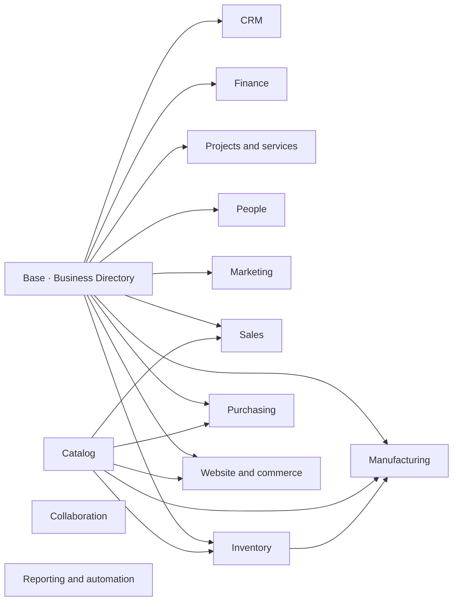

# ADR 0001 · User Preferences and ERP module activation

**Date** 18 November 2026

**Status** Implemented and verified locally. Hosted rollout requires separate approval.

[ADR 0005](0005-single-erp-api-deployment.md) supersedes the separate
business and Settings API deployment topology below. The authorization, model
and transaction rules continue to apply.

## Context

The shared ERP site builds its left menu from frontend flags and backend release
bindings. APIs mount their routes when their process starts. Neither mechanism
stores a person's menu choices or provides an Environment-wide activation rule
that applies consistently across module APIs, workers and internal calls.

Modules own their business services, models, migrations and releases. A handoff
such as order-to-invoice still requires the exact same governed DataSource so
Sales and Finance can commit their own statements in a single transaction.
[Module registry](../../../src/erp/modules.py) · [Finance handoff](../../../docs/finance/concepts.md)

## Decision

Name the shared ERP backend capability **User Preferences** (`user_preferences`).
It owns saved personal ERP preferences, starting with module visibility. It also
serves an administrator-controlled activation record. Use separate records,
routes and write permissions for these two scopes.

| Setting | Owner and scope | Effect |
| --- | --- | --- |
| **Settings → User Preferences** | The verified person, within the current Organization Environment | Saves which eligible optional modules the person hides from their left menu. |
| **Settings → Modules** | An authorized administrator, for the current Organization Environment | Controls which deployed optional modules may serve business requests. |

**Base is required and always active.** Business Directory and the existing Base
destinations in Settings always appear in navigation. Both editors omit Base
from their choices. The server adds Base implicitly and rejects its key in
optional activation and personal visibility payloads. Base keeps its existing
operation permissions for each destination.

A module is eligible for business access when the server has approved its
deployment, the Environment has activated it, and the actor has the existing
permission for the operation. Integrations also require their participating
modules and applicable permissions. The left menu displays eligible modules
that the person has chosen to show. A hidden module remains accessible through
an authorized direct link. An inactive module is denied at its business endpoints
for every caller, including an administrator.

For example, hiding Sales affects only that person's navigation. Deactivating
Sales removes its menu entry for everyone in the Environment and blocks new
Sales requests and Sales-to-Finance handoffs. Finance can still issue manual
invoices if its own access rules are met. Existing invoice snapshots remain
Finance records. Activation and personal settings preserve business data and
release state.

Settings, Business Directory and ERP bootstrap stay available when every
optional module is inactive. User Preferences has its own API entrypoint and
readiness independent of Base and CRM. Catalog has no direct owner dependency
on Base and Base remains installed for the ERP site.
Use the existing ERP site, Settings navigation entry and delegated Command
Center transport. Retain module-specific business APIs and migration providers.

## Data, identity and permissions

Use an additive, governed MetaTables migration owned by `src/erp/user_preferences/`.
Register a distinct provider and keep application routes under
`api/erp/user_preferences/`.

- Save one private personal record per `(organization_environment_uid, person_uid)`.
  Store typed `hidden_module_keys`, an edit version and update metadata. An
  absent record defaults to showing all eligible modules. An empty list resets
  that choice. Keep hidden keys through deactivation and reactivation. Reject
  unknown module keys and fields. Extend the schema with typed fields as future
  preferences are agreed.
- Save one versioned activation record per Organization Environment, with the active
  optional module keys and an append-only history of changes. Audit scope, verified actor,
  previous and new selections, time and request identifier. Commit the audit and
  policy change together. Keep transaction admission locks separate from policy data.
- Resolve the Environment from verified backend context, including the hosted
  middleware's `request.state.organization_environment_uid`. A local launcher
  must bind to its verified local runtime. Resolve the person from the verified
  requester or authenticated human caller. Scope reads and writes to this
  server-derived identity. Personal routes accept only the person's own preferences.
- Use existing platform organization administrator authority for
  `erp.modules.manage` initially. Existing module and Team permissions continue
  to govern business actions. Give business runtimes only the governed policy
  read and admission operations they need. Give their workload runtimes
  `data_viewer` on `erp-module-policy` and `data_writer` on
  `erp-module-admission`. Give them no role on the private
  `erp-user-preferences` namespace. It contains personal preferences and the
  audit, and only the User Preferences service writes activation policy.
- Preserve Base's existing private language and timezone preferences and
  `/api/base/v1/preferences/` contract. Base retains its language reference
  ownership. Keep module visibility solely in User Preferences. Any future
  consolidation of locale fields needs a migration and compatibility decision.
  [Base preference model](../../../src/erp/base/metatables/__init__.py#L267) · [Base API ADR](../../base/adr/0001-base-api-foundation.md)

Verify the policy storage binding explicitly. A platform Environment does not
automatically select a MetaTables DataSource. Missing or inconsistent scope,
policy or source binding fails closed for business access. Seed a reviewed
initial active set for each Environment before enabling enforcement.

## Application API contracts

Use authenticated application contracts under `/api/erp/v1/`. The shared ERP
site calls them through the existing delegated transport.

| Route | Contract |
| --- | --- |
| `GET /api/erp/v1/bootstrap/` | Return verified scope, policy version, availability, activation and actor access separately, plus the personal visibility settings and management capability. |
| `GET /api/erp/v1/user-preferences/` | Return the verified person's own typed settings. Use version `0` for the default response before the first save. |
| `PUT /api/erp/v1/user-preferences/` | Replace the personal hidden module keys at the expected version. Version `0` creates the record only if absent. Scope and owner come from the verified request. |
| `GET /api/erp/v1/modules/` | Return deployment availability, selected optional modules, and the registered module and workflow dependencies. Before first initialization, an authorized administrator sees policy version `0`. |
| `POST /api/erp/v1/modules/preflight/` | Preview a complete target set at an expected policy version. Return required additions, unavailable prerequisites, active dependents that block removals, and affected workflows or running work. |
| `PUT /api/erp/v1/modules/` | Reauthorize, revalidate and atomically apply the complete set and audit using an expected version and request identifier. |

A verified administrator can preflight and initialize a reviewed set at version
`0` through these management routes. The first save creates the policy, its
lock and its audit entry together. Business bootstrap and admission fail closed
until initialization. A different version-`0` request after initialization
conflicts with the current policy.

Use `401` for missing identity, `403` for denied access with `module_disabled`
for inactive business modules, `409` for stale versions or dependency conflicts,
and `503` when policy cannot be evaluated. A preflight result is advisory.
Configure an explicit allowlist of compatible, guarded backend releases.
Frontend flags and release bindings constrain what the site can display.

## Module dependency graph

An arrow runs from a prerequisite to the module that needs it. Every incoming
arrow is required for activation. Base is always active. Catalog, Collaboration
and Reporting can each be the only active optional module. User Preferences
supplies the shared policy and Settings independently of this business graph.

The graph matches the current registry, including Manufacturing's direct use of
Base and Catalog. Use `resolve_modules()` to validate required edges, find
cycles and order dependencies before consumers. [Module registry](../../../src/erp/modules.py)

## Dependency models

Extend the existing code-owned `Module` definition for each registered module.
Keep administrator selections in the versioned activation record. The server
derives the graph and reverse dependencies from the registry.

| Definition | Fields and rules |
| --- | --- |
| `Module` | Stable `key`, `api_prefix`, `migration_provider` and `prerequisites`. Every listed prerequisite and its transitive prerequisites must be active. Collect versioned workflow requirements by module key. |
| `WorkflowDependency` | Stable workflow key and owning module, `required_modules`, a named server-side condition for record-dependent requirements, and a DataSource rule. Evaluate only for that workflow. Keep existing provider flags and each owner's operation permissions in force. |
| Environment activation | Trusted Environment, selected optional module keys and policy version. Base is implicit. Deployment approval, schema readiness and DataSource bindings are checked from server-owned configuration. |
| Personal preference | Trusted Environment, verified person, hidden optional module keys and edit version. Personal menu choices leave Base visible and the activation graph and workflow permissions intact. |

Workflow DataSource rules distinguish the normal owner contract, an explicit
same-source read check, and an atomic same-source transaction. Atomic writes
join owner-authored statements, version guards and audit in one transaction.
For example, the Finance `order_to_invoice` workflow requires Sales and uses an
atomic same-source transaction. The Finance module itself requires Base.

### Registered module models and requirements

The model column links to each module's existing MetaTable definitions and
names its main records. Workflow requirements in the last column are additional
to the module prerequisites shown in the graph.

| Module key | Main owned models | Required to activate | Additional workflow requirements |
| --- | --- | --- | --- |
| `base` | [Party, Affiliation, Address, OperatingCompany, Currency, Language, Settings, Preference, NumberSequence](../../../src/erp/base/metatables/__init__.py) | Always active | Existing CRM identity claims need the CRM compatibility projector on the same source. This integrity operation stays available when CRM business access is disabled. |
| `catalog` | [Item, Category, Unit, UnitGroup](../../../src/erp/catalog/metatables/__init__.py) | None | None across ERP modules. |
| `crm` | [Contact and Company profiles, BaseIdentityLink, Deal, Pipeline, Stage, Task, Interaction, Campaign, EmailThread](../../../src/erp/crm/metatables/__init__.py) | Base | Adopted identity changes require Base and CRM on the same source. |
| `sales` | [Order, OrderLine](../../../src/erp/sales/metatables/__init__.py) | Base, Catalog | Linking a CRM opportunity requires CRM owner reads. The existing adapter is local only. |
| `finance` | [Invoice, InvoiceLine, Payment, Allocation, Posting](../../../src/erp/finance/metatables/__init__.py) | Base | Order-to-invoice requires Sales on the same source. Manual invoices and payments need no Sales integration. |
| `projects` | [Project, DeliveryTask, TimeEntry](../../../src/erp/projects/metatables/__init__.py) | Base | Converting a service order requires Sales. Billing a delivered service order project requires Sales and Finance. Both are atomic handoffs. Catalog is required through Sales for that adapter. |
| `people` | [Employee, Department, AbsenceRequest](../../../src/erp/people/metatables/__init__.py) | Base | Staffing a delivery task requires an atomic handoff with Projects. |
| `collaboration` | [Discussion, Message, MessageRevision](../../../src/erp/collaboration/metatables/__init__.py) | None | Project-scoped discussions require Projects and its applicable permissions. Shared discussions work independently. |
| `marketing` | [Subscriber, Mailing, Recipient, DeliveryEvent](../../../src/erp/marketing/metatables/__init__.py) | Base | Linking an existing follow-up task requires CRM owner reads. The existing adapter is local only. |
| `inventory` | [Location, StockItem, Balance, Move, Entry](../../../src/erp/inventory/metatables/__init__.py) | Base, Catalog | Sales delivery requires Sales. Valuation posting and returns of already valued movements require Finance. These are atomic handoffs. Live valuation detail requires Finance read access. |
| `purchasing` | [Order, OrderLine, Receipt](../../../src/erp/purchasing/metatables/__init__.py) | Base, Catalog | A physical receipt requires Inventory. Draft vendor bills require Finance and also Inventory if physical receipt movements must be validated and fenced. Services can be accepted without Inventory. Receipt creation and billing are atomic. |
| `manufacturing` | [Bom, BomLine, Production, WorkStep](../../../src/erp/manufacturing/metatables/__init__.py) | Base, Catalog, Inventory | Production stock moves require a same-source transaction with Inventory. Posting production valuation additionally requires Finance. |
| `commerce` | [Site, Offer, PortalGrant, Checkout](../../../src/erp/commerce/metatables/__init__.py) | Base, Catalog | Checkout requires Sales. Draft invoicing requires Sales and Finance. Both are atomic. Recorded payment status reads Finance on the same source. |
| `reporting` | [Definition, Run, RunStep, Schedule](../../../src/erp/reporting/metatables/__init__.py) | None | Commercial reports require Sales and Finance. Operations reports require Projects, Inventory, Purchasing and Manufacturing. Capture and access to saved results require the full source group, current owner read access and the same governed source. |

User Preferences has proposed models for the private `UserPreference`,
`EnvironmentModuleActivation`, `ModuleActivationChange` and separate
`ModuleAdmissionLock` records described above. Its migration provider owns only
these infrastructure records.

The Base-to-CRM projection is a storage integrity obligation for existing claims.
Treating it as an activation edge would create a false cycle. Similarly,
Finance and Inventory can activate independently of each other when their hard
prerequisites are met. Returning a Finance-posted movement still requires Finance
to reverse the valuation in the return transaction.
[Identity composition](../../../src/erp/identity_composition.py) · [Inventory returns](../../../docs/inventory/concepts.md) · [Purchasing receipt guards](../../../src/erp/purchasing/service.py#L499) · [Reporting sources](../../../src/erp/reporting/sources.py)

## Activation and deactivation

On enable, preflight expands the request to every direct and transitive
prerequisite. For example, selecting Manufacturing with only Base active
proposes Catalog, Inventory and Manufacturing. The workspace already has Base.
If Inventory is unapproved,
incompatible or unprovisioned, the proposal is blocked and names the reason.
The affected release and migration providers must be ready before activation.
A hard edge requires active, compatible owner capability and schema. An owner
contract can be called in-process, as several APIs do today.

On disable, compute all active reverse dependents. With Manufacturing active,
disabling Inventory alone fails. Show the dependent removal the administrator
can review, along with affected workflows such as Purchasing physical receipt.
An optional workflow losing access does not require deactivating its owner.
Evaluate record-dependent blockers on affected commands, such as the return of
an already valued movement, and present those impacts in Settings when known.

The administrator confirms one complete target set. Save rechecks approval,
readiness, dependencies and the expected policy version, then commits the
complete set and audit atomically. Settings never enables prerequisites or
removes dependents silently. Use prerequisite order for provisioning and
migration, reverse order for reviewing removals, and one policy commit for
activation. The UI calls out missing prerequisites separately from unavailable
deployment bindings and missing workflow participants.

## Enforcement and transaction safety

Check activation after authentication at each business API router and again at
shared operation boundaries used outside HTTP. Include direct owner service
calls, existing CRM MCP tools, imports, exports, file downloads, saved report
results and worker claims or checkpoints. Maintain an explicit inventory of
business routes and exceptions for minimal health, settings and protocol ingress.
Callbacks must check policy before invoking business work. Pause disabled work
at a safe checkpoint and allow controlled resumption. Pending external effects
require explicit resume rules.

Deactivation takes effect when the policy change commits. New requests must see
the committed policy across all API processes. Reads already admitted may finish.
A business mutation admitted earlier must commit before deactivation or roll back.
Business writes take the Environment's separate admission lock and verify the
policy version inside the governed transaction. Policy updates take the same
lock. Verify least privilege, retries, contention, compiler statement
limits and rollback. Keep the guard and all business statements on the same
governed DataSource. A module on another source needs a verified drain or fencing
design before it can support this toggle guarantee. Frontend refresh only updates
the display and plays no role in API enforcement.

Keep CRM's Base adoption compatibility checks and identity projection available
as a narrowly scoped integrity operation. Deactivating CRM closes business access
while this operation continues to synchronize existing claimed identities. Fail
affected Base writes if the required projection is unavailable. Keep adoption
enabled and preserve compatibility during recovery.
[CRM projection composition](../../../src/erp/identity_composition.py) · [CRM cutover verification](../../crm/base-adoption/verification.md)

## Frontend behavior

Fetch ERP bootstrap after Command Center host and transport initialization.
Resolve the route against module availability, activation and actor access
before starting that module's business client. Build the left menu from those
same inputs and personal preferences. Keep existing routes, including CRM deep
links. Choose a visible eligible home destination or fall back to Settings.
Even if a person hides every optional module, Business Directory and Settings
remain visible and Settings lets them restore their choices.

Keep the personal visibility form and administrator activation form separate.
Apply changes after the corresponding save succeeds. Refresh bootstrap on save,
reconnect, identity changes and browser focus. On a `module_disabled` response,
refresh policy and clear affected data and routes. Personal hiding alone does
not revoke authorization or close a currently open authorized route. Update the
shared ERP guide and verify desktop and mobile Settings and navigation.

## Delivery and acceptance

1. Verify the expected local MetaTables DataSource, initialized SQLite and local
   mode before migrations or write tests. Implement the additive migration,
   personal preference persistence, policy, bootstrap and authorization. Prove
   the transaction guard in the actual local runtime.
2. Add enforcement to every supported module and internal operation boundary.
   Verify graph coverage for all registered modules, independent activation,
   transitive additions, blocked removals, blocked provisioning and conditional
   workflows. Test disabled access, stale saves, policy outages, concurrent
   writes, worker resumption, dependent reports, CRM projections and data
   preservation after reactivation.
3. Integrate the frontend and help pages. Verify private preferences persist
   across sessions, one user's changes leave another user's menu alone, and the
   same person has isolated choices across Environments. Verify that personal
   settings cannot activate a module or grant permissions. Test deep links,
   zero visible optional modules, Base-only activation, refresh and reconnect with real
   locally authenticated APIs and the normal ERP shell.
4. Prepare a compatible release set and recovery procedure. Verify enforcement
   before exposing administrator changes. Hosted release requires explicit
   approval after local verification. Hosted permission grants, production
   transaction behavior and populated CRM cutover reconciliation and recovery
   require separate evidence.

Local migration, API, browser and remaining release evidence is recorded in
[User Preferences operations](../user-preferences-operations.md).
